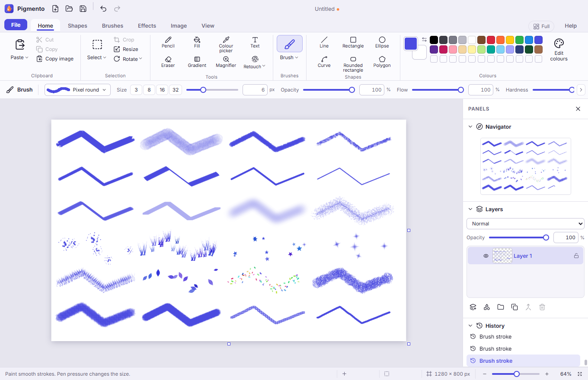
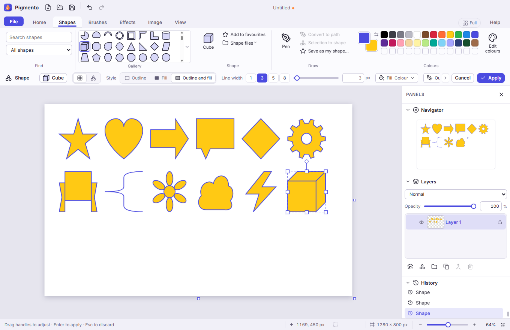
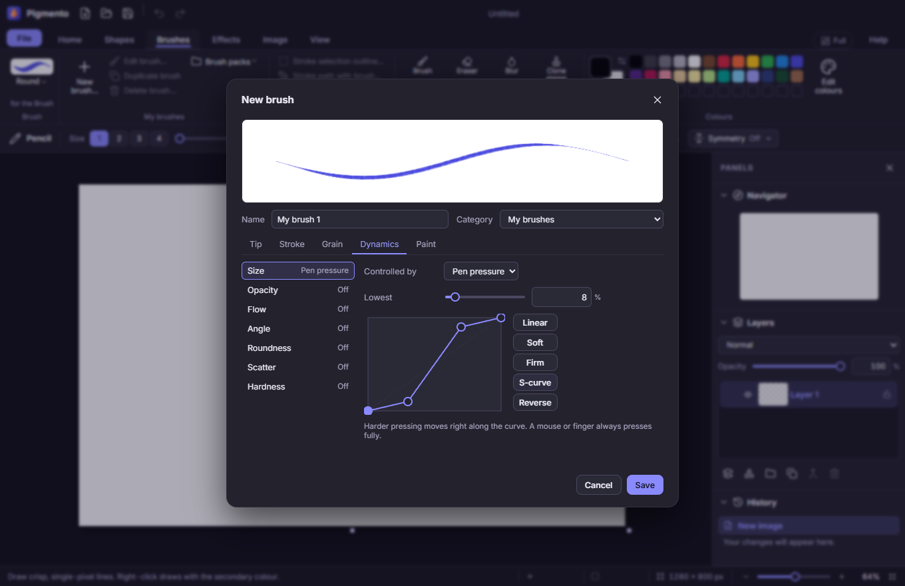
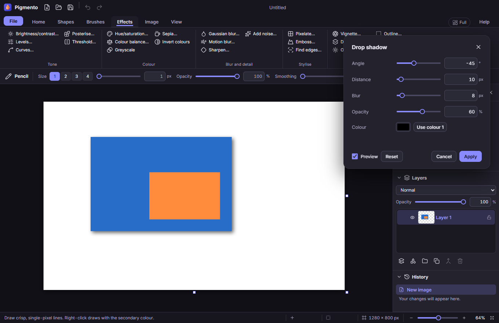

# Pigmento

> *Paint simply. Create boldly.*

Pigmento is a painting app for Windows 11 with the classic Paint layout. It also has layers, more than 150 editable shapes, 50 brushes with a brush designer, and live adjustments and filters, for when you want them.



## Features

- **Everything Paint does:** pencil, brush, eraser, fill, colour picker, magnifier, text, line and curve, rectangles, ellipses and polygons. You can also select, crop, resize, rotate and flip, copy and paste, print, and set the picture as your desktop background.
- **Two modes:** Simple keeps the Paint essentials, and Full adds everything below. Switch at any time.
- **Layers:** groups, 15 blend modes, opacity, merging and flattening, and editable shape layers. Projects (`.pigm`) keep all of it. PNG, JPEG, WebP, BMP and GIF open and save too.
- **Selections:** rectangle, ellipse, free-form, polygon, magic wand and colour range; add, subtract and intersect; feather, grow, shrink and border; saved selections; free transform with skew and perspective.
- **Shapes:** more than 150 shapes with sliders, gradient and pattern fills, dashes and arrowheads, and a pen for your own paths. Shapes can go into My shapes, travel as shape packs, and come in from SVG.
- **Brushes:** 50 brushes with pressure, tilt and speed dynamics, a stabiliser, symmetry, and Shift for straight lines. There are retouch tools (smudge, blur, sharpen, clone stamp, dodge and burn), and you can stroke outlines and paths with any brush.
- **Brush Designer:** make your own brushes from a built-in tip, the selection, a PNG or a tip you draw, with grain textures and response curves. Share them as brush packs (`.pigmbrush`).
- **Effects:** 11 adjustments and 11 filters with a live preview. They work on the selection, and run in the background with progress on big pictures.
- **View aids:** zoom, rulers, gridlines and pixel grid, guides and snapping, turning the view, and a reference image.
- **Made for everyone:** keyboard-friendly throughout (F6 moves between regions), with customisable shortcuts and an adjustable interface size. There are six themes, each in light and dark, including high contrast, and the app passes an automated WCAG 2.1 AA check.
- **Safe with your work:** autosave and recovery, plain-language errors, a log for problems, and checks before pictures too big for memory.

| | |
|---|---|
|  |  |
|  | |

The [user guide](docs/user-guide.md) explains everything; it's also in the app under Help → User guide.

## Installing

Build the installer (see below), then run one of these from `dist/`:

- **`Pigmento Setup 1.0.0.exe`** installs Pigmento for your user account only, with no administrator rights needed. It adds Start menu and desktop shortcuts, opens `.pigm` projects, and adds Pigmento to "Open with" for PNG, JPEG, BMP, GIF and WebP. It never changes your default image viewer. Uninstall it from Settings → Apps.
- **`Pigmento-1.0.0-portable.exe`** runs without installing.

The builds aren't code-signed, so Windows SmartScreen may warn the first time. Choose **More info → Run anyway**.

Pigmento keeps its settings, your shapes, brushes and patterns, recovery copies and its log in `%APPDATA%\Pigmento`.

## Building from source

You need Windows 11, [Node.js](https://nodejs.org) 26 (with npm 11) and Git. Nothing else is installed system-wide. Run these in PowerShell:

```powershell
npm install          # dependencies
npm run dev          # start the app with hot reload
npm run build        # production build into out/
npm start            # run the production build
npm run dist         # build dist/Pigmento Setup 1.0.0.exe and the portable exe
```

| Command | What it does |
|---|---|
| `npm run check` | Lint, type-check, unit tests and end-to-end tests. Must pass before a change is done |
| `npm test` | Unit tests (Vitest) |
| `npm run e2e` | Builds, then runs the end-to-end tests (Playwright driving the Electron app) |
| `npm run smoke:installed` | Installs the built installer, smoke-tests the installed app, then uninstalls it |
| `npm run icons` | Regenerates `build/icon.ico` and the PNG icons from `resources/logo.svg` |
| `npm run lint`, `npm run typecheck` | ESLint and TypeScript on their own |

The end-to-end tests use a temporary profile, so they never touch your real settings. A few extras are opt-in:

| Variable | Effect |
|---|---|
| `PIGMENTO_E2E_CLIPBOARD=1` | Also tests the real Windows clipboard (it overwrites what you copied) |
| `PIGMENTO_SCREENSHOT=1` with `PIGMENTO_SCREENSHOT_DIR=<folder>` | Saves screenshots of the interface for review |
| `PIGMENTO_UPDATE_GOLDEN=1` | Rewrites `tests/golden/` after an intended change to a built-in shape or brush |

## How it's built

Pigmento is an Electron app. Its React interface sits on a painting engine written in plain TypeScript, which never imports React:

- **Pixels:** pictures live in tiled surfaces (256 px tiles, copy-on-write), so undo stores only the tiles that changed.
- **Heavy work:** decoding, flood fill and filters run in Web Workers.
- **Security:** the window runs with context isolation and a sandbox, a strict Content Security Policy, a typed preload bridge, and no remote content.

[`PLAN.md`](PLAN.md) has the full architecture and the milestone checklist, and [`CLAUDE.md`](CLAUDE.md) has the conventions. The file formats are documented in [`docs/project-format.md`](docs/project-format.md), [`docs/shape-format.md`](docs/shape-format.md), [`docs/brush-format.md`](docs/brush-format.md) and [`docs/palette-and-svg.md`](docs/palette-and-svg.md).

## Licences

Pigmento's own code, logo, cursors and palette are original work. Third-party components and their licences are listed in [`LICENSES.md`](LICENSES.md); they're also shown in the app under Help → About Pigmento.

See [`CHANGELOG.md`](CHANGELOG.md) for what's in each version.
